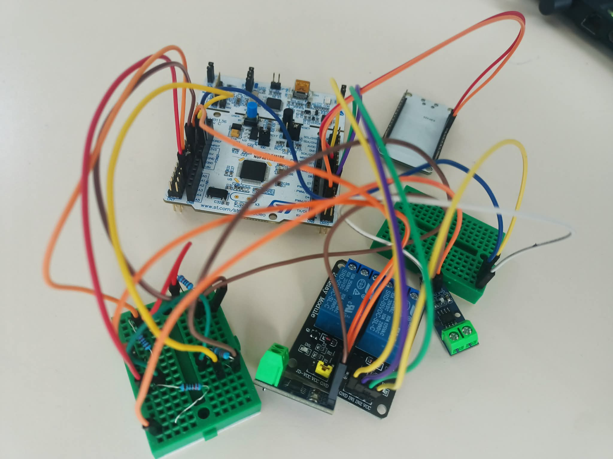

# ⚡ PromptWATT-Lite — Smart DC Power Monitoring & Control

> Embedded Systems course project · SMU MedTech · Sep – Dec 2025

A **two-channel DC power monitoring and control system** that measures voltage, current and power in
real time, shows them on a web dashboard, and lets an **AI assistant** help manage loads safely.

  

## 🧩 How it works

| Layer | Details |
|---|---|
| **Sensing** | Analog voltage/current sensing circuits on two DC channels |
| **Firmware** | STM32 handles real-time acquisition and load switching |
| **Connectivity** | ESP32 Wi-Fi module streams data to the dashboard |
| **Supervision** | Web dashboard for live readings and control |
| **AI control** | An LLM with a strict system prompt and a small set of tools can read measurements and switch loads within safety rules. Several models were benchmarked for accuracy, speed and resource use. |

## 🎥 Demo

[▶️ Watch the demo video](media/demo.mp4)

## 📄 Documents

- [Full project report (32 pages)](docs/PromptWATT-Lite_Report.pdf) — design, circuits, AI architecture, LLM benchmark, diagrams and code

## 👥 Team

Ibrahim Fourati · Louay Arfa · Camille Badji · **Mohanad Alfarra**
